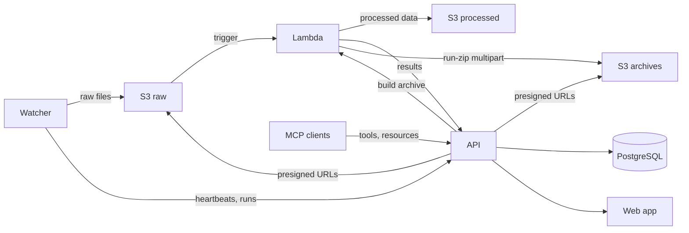

<Audience>Engineers and operators</Audience>

Data Hub has four components that work together through S3, a REST API, and a shared Python library. This page explains how they fit together. The [first-time deployment guide](https://github.com/Arcadia-Science/data-hub/blob/production/docs/developer/first-time-deployment.md) in the data-hub developer docs explains how to deploy them.

## System overview

## Components

| Component | Package | Description |
| --- | --- | --- |
| Web app | `data-hub-web` | Next.js web app, REST API, and MCP server. Deployed on Vercel. |
| Lambda | `data-hub-lambda` | AWS Lambda function that runs instrument-specific processing when a file is uploaded to S3. |
| Watcher | `data-hub-watcher` | CLI on lab instrument PCs. Finds new files, uploads them to S3, and reports status to the API. |
| Shared library | `data-hub-shared` | Shared Python library: S3 utilities, instrument enums, and test infrastructure. |

## Data flow

### Automatic upload (auto mode)

1. A lab instrument writes output files to a watch folder.
2. The **watcher** finds new files through file system events and waits until each one stops changing.
3. It groups files into runs and reports each run to the **API**.
4. It uploads raw files to **S3** at the key `{instrument_id}/{run_id}/{filename}`.
5. The S3 upload starts the **Lambda**.
6. The Lambda passes the file to the instrument’s processor, which reads it. When the deployment turns the option on, some processors read large files from a read-only mount of the raw bucket instead of downloading them. This covers processors that read a file in pieces, for files of 1 GiB or more or too large for the Lambda’s disk.
7. The Lambda creates or updates the run and its files through the **API**, which sends a **Slack** notification once for each new run.
8. People view the run in the **web app**.

### Manual upload (manual mode)

Steps 1–3 are the same, but the watcher doesn’t upload right away:

4. The server adds files to an upload queue.
5. Once a minute, the watcher checks the queue and uploads the files someone requested.
6. Steps 5–8 from auto mode follow.

Auto-mode watchers check the same queue, so **Upload** on a run page works for them too.

## Key design decisions

- **S3 is the integration boundary.** The watcher and the Lambda never talk to each other. The watcher writes files to S3, and the Lambda reads them from there.
- **API-driven coordination.** The watcher registers with the API, syncs its YAML config, and sends heartbeats. Watcher health in the web app and the upload queue both depend on those calls.
- **Pre-signed URLs from the API.** The web app creates pre-signed S3 upload and download URLs. File contents then move directly to and from S3 without passing through the API. On Vercel, the app assumes an AWS Identity and Access Management (IAM) role through OpenID Connect (OIDC), so it needs no long-lived AWS keys.
- **Lambda-built run archives.** **Download all** hands the work to the Lambda, which zips the files into a separate archives bucket with an S3 multipart upload. The web app then redirects the browser to a short-lived pre-signed URL. File contents never pass through Vercel.
- **Shared library for contracts.** Instrument IDs, S3 utilities, and environment config live in `data-hub-shared`, so the Lambda and the watcher stay consistent.
- **MCP for AI access.** The web app serves an MCP endpoint at `/mcp/v1` that offers tools, resources, and prompts to AI clients. Clients sign in with OAuth through the same Better Auth instance that signs people in to the web app. An agent therefore acts as the person who approved it. See [MCP overview](/docs/mcp).

## Branch and environment strategy

| Branch | Purpose |
| --- | --- |
| `staging` | Pre-production. Pull requests merge here first. |
| `production` | Live. Changes are promoted from `staging`. |

Feature branches target `staging` through pull requests (PRs). Continuous integration (CI) runs on every PR and on merges to both branches. Merges to `staging` and `production` deploy each component to its environment automatically. Staging and production are separate deployments with separate databases.
